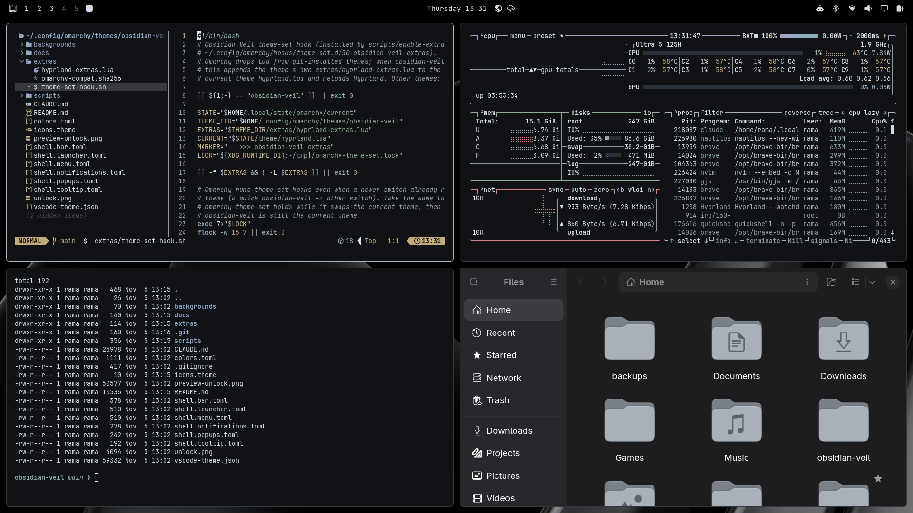
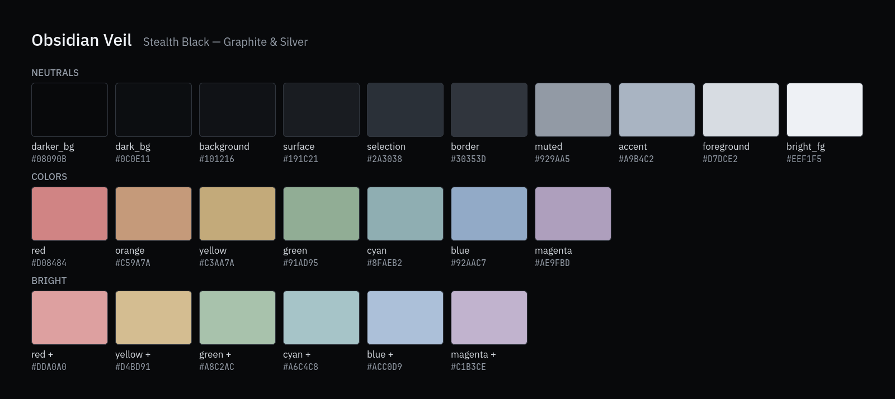
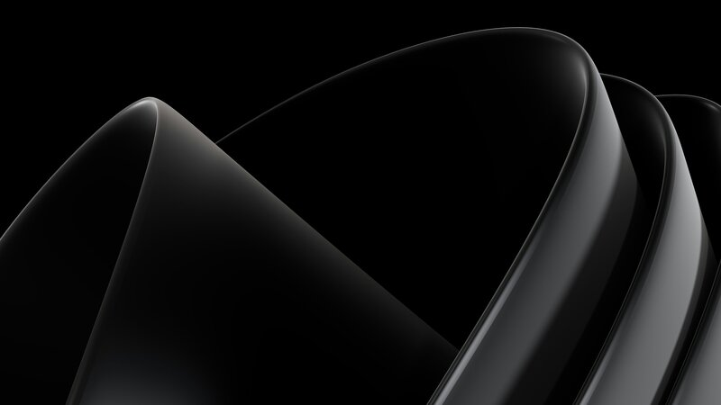
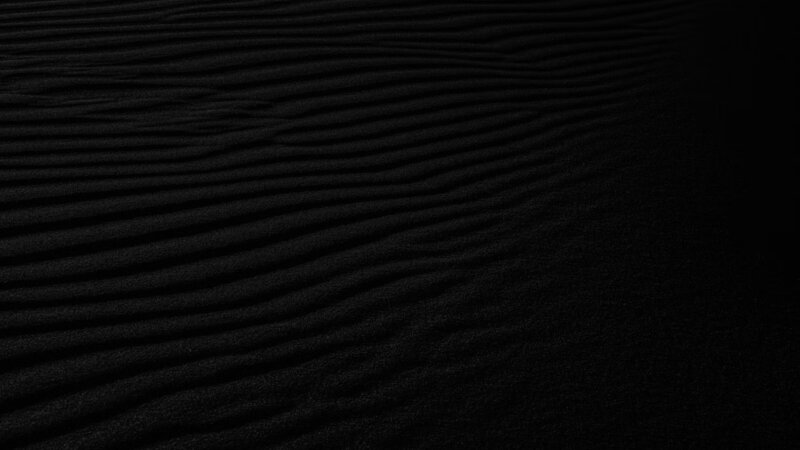
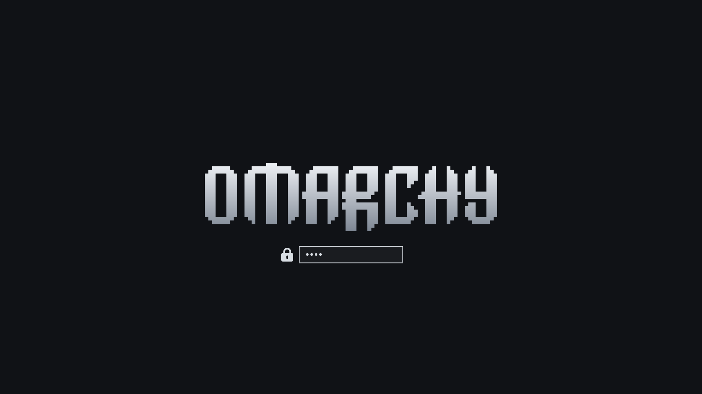

# Obsidian Veil — Graphite & Silver

A layered matte-black theme for [Omarchy](https://omarchy.org) with quiet graphite and silver accents, made for long coding sessions in VS Code, the terminal, Claude Code and Codex. The palette is called "Stealth Black". Built and tested on **Omarchy 4.5** (Hyprland Lua + Omarchy shell).

[Bahasa Indonesia](README.id.md)



## Palette



Several levels of black separate the wallpaper, windows, panels and selections. Silver is used only for focus, selection, the cursor and active indicators. The semantic colours (errors, warnings, Git diff, syntax) are softened but kept, so code never turns grayscale. Main text reaches about 13.6:1 contrast against the background, and muted text about 6.6:1 (WCAG). See [`docs/design.md`](docs/design.md).

## Wallpapers

| Black Ribbons (default) | Black Dune |
| --- | --- |
|  |  |
| Andrew Kliatskyi, [Unsplash](https://unsplash.com/photos/curved-black-ribbons-with-highlights-7og8GybWcZw) | [Unsplash](https://unsplash.com/photos/a-black-and-white-photo-of-a-sand-dune-kz63JaDm9V4) |

The optional [extras](https://github.com/ramaanindyaa/obsidian-veil-extras) can add three more from the [Resend collection](https://resend.com/wallpapers) by Raphael Fagundes (Pilulae, Discus, Cubus). They are downloaded to your machine and never committed, because their redistribution terms are unclear. Sources and licenses: [`docs/wallpaper-sources.md`](docs/wallpaper-sources.md).

## Install

```bash
omarchy theme install https://github.com/ramaanindyaa/omarchy-obsidian-veil-theme
```

This installs and applies the theme: colours, bar, menus, notifications, terminal, VS Code and wallpapers. The repository contains only theme files and runs nothing.

### Optional extras

Omarchy strips `*.lua` files from themes installed with git, and a theme cannot install hooks. The finishing touches therefore live in a separate repository, [obsidian-veil-extras](https://github.com/ramaanindyaa/obsidian-veil-extras): 1 px borders, 5 px corners and short animations through an Omarchy `theme-set` hook, graphite folder icons, the IBM Plex Sans menu font, the Resend wallpapers, VS Code and foot fonts, a backup with automatic rollback, and validation tools. Everything works without them.

## Usage

- Apply: Omarchy menu → Theme → **Obsidian Veil**, `omarchy theme set obsidian-veil`.
- Change wallpaper: `omarchy theme bg next` or `omarchy theme bg-switcher`. Extra wallpapers (jpg/png/webp, **not** avif) can go in `~/.config/omarchy/backgrounds/obsidian-veil/`.
- Update from GitHub: `omarchy theme update`.

### Typography

| Area | Font | Size |
| --- | --- | --- |
| VS Code editor | JetBrains Mono (icon fallback JetBrainsMono Nerd Font) | 14 px, 22 px line height, weight 400, ligatures off |
| VS Code terminal | JetBrainsMono Nerd Font | 14 px |
| foot (Claude Code, Codex) | JetBrainsMono Nerd Font | 11 pt |
| Launcher/menu | IBM Plex Sans (Medium for row titles) | shell default |
| Bar, clock, notifications | unchanged: `monospace` alias / Liberation Sans (shell limitation) | — |

Font packages: `sudo pacman -S --needed ttf-jetbrains-mono ttf-ibm-plex`. The VS Code and foot font settings are applied by the optional [extras](https://github.com/ramaanindyaa/obsidian-veil-extras) (`typography.sh`), which refuses to run if they are missing. Details: [`docs/typography.md`](docs/typography.md).

### Folder icons

`icons.theme` sets `Yaru-sage` as a neutral fallback that always exists on Omarchy. The optional [extras](https://github.com/ramaanindyaa/obsidian-veil-extras) (`enable-extras.sh --hook`) build a local icon theme, **ObsidianVeil-Graphite**, in `~/.local/share/icons/` (`scripts/build-icons.sh`) by recolouring the system's 263 Yaru-blue accent icons (folders, places) to a graphite range `#2A3038` → `#C9D0D9`; everything else is inherited from Yaru. The hook selects it only while Obsidian Veil is active. The Yaru derivative (CC BY-SA 4.0) is built locally and not committed.

### Unlock screen (Plymouth)



`unlock.png` is the Omarchy wordmark (from the built-in matte-black theme, MIT) with a silver gradient `#EEF1F5` → `#7E8794` and no glow, on `#101216`. It is **not applied automatically**, because it needs sudo and changes the boot/decryption screen:

```bash
omarchy plymouth set by theme obsidian-veil   # apply (asks for your sudo password)
omarchy plymouth reset                        # back to the Omarchy default
```

The session lock screen is a separate component (Omarchy shell) and already follows the theme through the `[lock]` section.

## Repository layout

```text
colors.toml              Omarchy canonical palette (+ Hyprland border colours)
shell.*.toml             bar/popup/notification/tooltip/launcher/menu overrides
vscode-theme.json        VS Code theme (rendered from Omarchy's template)
backgrounds/             Black Ribbons (default) and Black Dune, Unsplash License
preview.png              real screenshot for the theme switcher
unlock.png               Plymouth unlock logo (LUKS/boot)
preview-unlock.png       real render from `omarchy plymouth preview`
docs/                    design, typography, wallpaper sources, validation, images
```

## Optional

- **Claude Code**: an "Omarchy" palette is already available. Pick `custom:omarchy` with `/theme`, or run `omarchy-theme-set-claude --activate`.
- **Codex** follows the terminal's ANSI colours.

## Limitations

- Depends on Omarchy 4.5 internals: `shell.<section>.toml` overrides, `OMARCHY_MENU_FONT`, the `hyprland.lua` template and state paths. The [extras](https://github.com/ramaanindyaa/obsidian-veil-extras) include `validate.sh --installed` and `check-compat.sh` to check them after upgrading Omarchy.
- ANSI slot 0 is the background colour (an Omarchy rule), so explicit "black" text has low contrast.
- Black Dune is only 1400×933, so it is upscaled when shown as *cover*.
- `preview.png` is a real 1920×1080 screenshot (no upscaling), while the built-in themes use 2560×1440. The terminals in the preview use 8 pt so btop fits a quarter of the screen; the everyday foot size is 11 pt.
- The design spec in `CLAUDE.md` and some documents under `docs/` are written in Indonesian.
