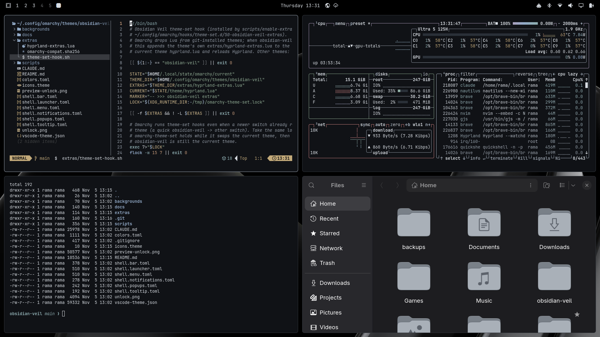
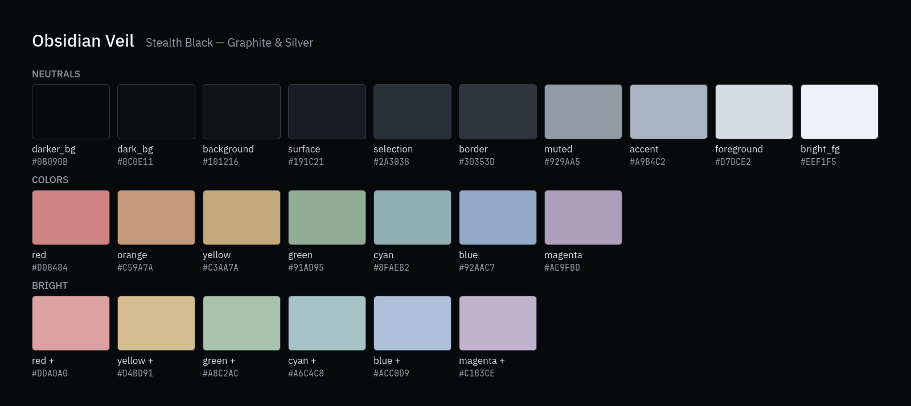
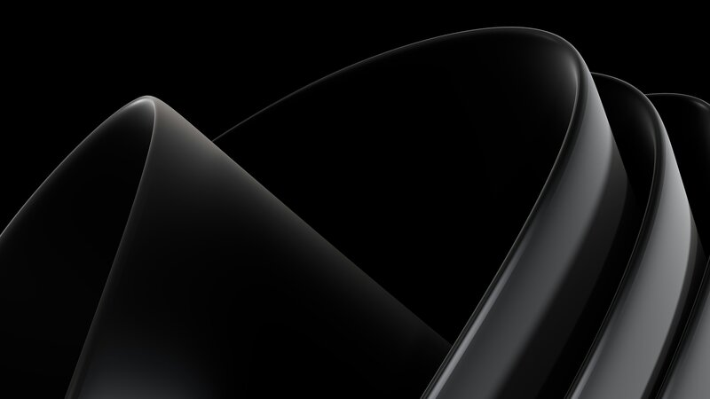
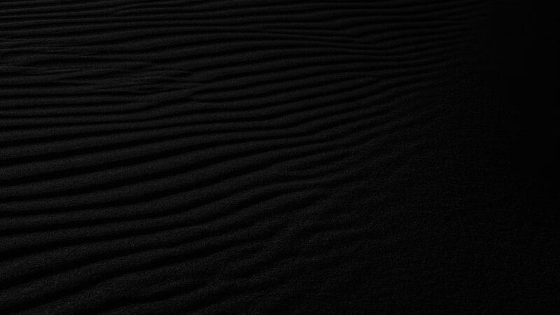
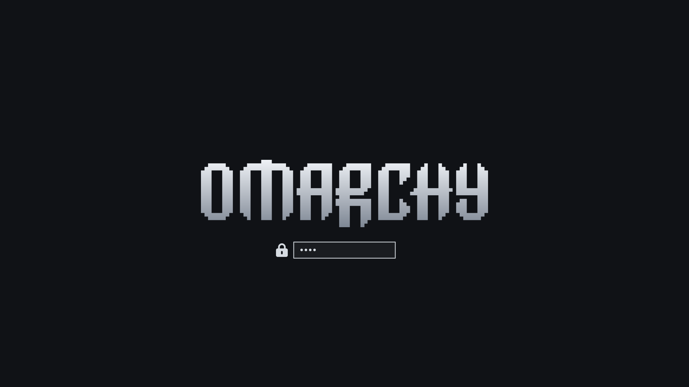

# Obsidian Veil — Graphite & Silver

A layered matte-black theme for [Omarchy](https://omarchy.org) with quiet graphite and silver accents, made for long coding sessions in VS Code, the terminal, Claude Code and Codex. The palette is called "Stealth Black". Built and tested on **Omarchy 4.5** (Hyprland Lua + Omarchy shell).

[Bahasa Indonesia](README.id.md)



## Palette



Several levels of black separate the wallpaper, windows, panels and selections. Silver is used only for focus, selection, the cursor and active indicators. The semantic colours (errors, warnings, Git diff, syntax) are softened but kept, so code never turns grayscale. Main text reaches about 13.6:1 contrast against the background, and muted text about 6.6:1 (WCAG). See [`docs/design.md`](docs/design.md).

## Wallpapers

| Black Ribbons (default) | Black Dune |
| --- | --- |
|  |  |
| Andrew Kliatskyi, [Unsplash](https://unsplash.com/photos/curved-black-ribbons-with-highlights-7og8GybWcZw) | [Unsplash](https://unsplash.com/photos/a-black-and-white-photo-of-a-sand-dune-kz63JaDm9V4) |

`enable-extras.sh --wallpapers` adds three more from the [Resend collection](https://resend.com/wallpapers) by Raphael Fagundes (Pilulae, Discus, Cubus). They are downloaded to your machine and never committed, because their redistribution terms are unclear. Sources and licenses: [`docs/wallpaper-sources.md`](docs/wallpaper-sources.md).

## Install

### Option 1 — `omarchy theme install` + extras (all features)

```bash
omarchy theme install https://github.com/ramaanindyaa/omarchy-obsidian-veil-theme
~/.config/omarchy/themes/obsidian-veil/scripts/enable-extras.sh --all
```

The first command installs and applies the core theme (colours, bar, menus, notifications, terminal, VS Code, wallpapers). The second runs once per machine and adds what `omarchy theme install` cannot ship:

| Option | What it does |
| --- | --- |
| `--hook` | Official Omarchy `theme-set` hook: 1 px borders, 5 px corners, 120–180 ms animations, solid terminals and Nautilus, IBM Plex Sans menu font, graphite folder icons |
| `--wallpapers` | Downloads Pilulae, Discus and Cubus (Resend) into `~/.config/omarchy/backgrounds/obsidian-veil/` |
| `--typography` | VS Code and foot fonts (see below), with a backup |
| `--all` | All of the above (default) |

Why the second step? For safety, Omarchy strips every `*.lua` file from themes installed with git. The Hyprland decoration therefore lives in `extras/hyprland-extras.lua`, and the hook appends it to the active theme's `hyprland.lua` each time Obsidian Veil is applied. When you switch to another theme, that file is regenerated and the decoration goes away with it. `omarchy theme update` also pulls changes to `extras/hyprland-extras.lua`.

### Option 2 — one command, with backup and automatic rollback

```bash
git clone https://github.com/ramaanindyaa/omarchy-obsidian-veil-theme.git ~/obsidian-veil
~/obsidian-veil/scripts/install.sh            # add --dry-run to see the plan first
```

`install.sh`:
1. Records the current theme, wallpaper and VS Code settings in `~/.local/state/obsidian-veil/`.
2. Installs the hook.
3. Runs `omarchy theme install`.
4. Runs `enable-extras.sh --wallpapers --typography`.
5. Sets Black Ribbons as the starting wallpaper.
6. Checks `hyprctl configerrors` and rolls back automatically if new errors appear.

Options: `--local` (clone from this working copy), `--url <git-url>`, `--no-extras`.

### Wallpapers follow the theme

Once the hook is installed (`--hook`, once per machine), wallpapers come and go with the theme:

| Wallpapers | On `omarchy theme install` / `theme set obsidian-veil` | On `omarchy theme remove obsidian-veil` |
| --- | --- | --- |
| Black Ribbons, Black Dune (in the repo) | Cloned with the theme | Removed with the theme folder |
| Resend (not in the repo), plus any local extras whose originals are in `~/Pictures/obsidian-veil/` | Built in the background by the hook if missing (from local originals when available, otherwise downloaded). After a failure, retried at the next `theme set`, at most once an hour | Removed by the hook at the next theme switch or next login (post-boot hook `50-obsidian-veil-cleanup`), because `omarchy theme remove` has no hook of its own |

Only files created by the project and left unchanged are removed. The wallpaper currently on screen stays until you change it. Originals in `~/Pictures/obsidian-veil/` are never touched. Download log: `~/.local/state/obsidian-veil/auto-wallpapers.log`. To turn off automatic downloads: `touch ~/.local/state/obsidian-veil/no-auto-wallpapers`.

On a new machine the hook does not exist until `enable-extras.sh` has run once; `omarchy theme install` cannot install hooks by itself.

## Usage

- Apply: Omarchy menu → Theme → **Obsidian Veil**, `omarchy theme set obsidian-veil`, or `scripts/apply.sh` (with an error check).
- Change wallpaper: `omarchy theme bg next` or `omarchy theme bg-switcher`. Extra wallpapers (jpg/png/webp, **not** avif) can go in `~/.config/omarchy/backgrounds/obsidian-veil/`.
- Update from GitHub: `omarchy theme update`.
- Validate: `scripts/validate.sh --installed`.

### Typography

| Area | Font | Size |
| --- | --- | --- |
| VS Code editor | JetBrains Mono (icon fallback JetBrainsMono Nerd Font) | 14 px, 22 px line height, weight 400, ligatures off |
| VS Code terminal | JetBrainsMono Nerd Font | 14 px |
| foot (Claude Code, Codex) | JetBrainsMono Nerd Font | 11 pt |
| Launcher/menu | IBM Plex Sans (Medium for row titles) | shell default |
| Bar, clock, notifications | unchanged: `monospace` alias / Liberation Sans (shell limitation) | — |

Font packages: `sudo pacman -S --needed ttf-jetbrains-mono ttf-ibm-plex`. `scripts/typography.sh` refuses to run if they are missing. Details: [`docs/typography.md`](docs/typography.md).

### Folder icons

`icons.theme` sets `Yaru-sage` as a neutral fallback that always exists on Omarchy. `enable-extras.sh --hook` builds a local icon theme, **ObsidianVeil-Graphite**, in `~/.local/share/icons/` (`scripts/build-icons.sh`) by recolouring the system's 263 Yaru-blue accent icons (folders, places) to a graphite range `#2A3038` → `#C9D0D9`; everything else is inherited from Yaru. The hook selects it only while Obsidian Veil is active. The Yaru derivative (CC BY-SA 4.0) is built locally and not committed.

### Unlock screen (Plymouth)



`unlock.png` is the Omarchy wordmark (from the built-in matte-black theme, MIT) with a silver gradient `#EEF1F5` → `#7E8794` and no glow, on `#101216`. It is **not applied automatically**, because it needs sudo and changes the boot/decryption screen:

```bash
omarchy plymouth set by theme obsidian-veil   # apply (asks for your sudo password)
omarchy plymouth reset                        # back to the Omarchy default
```

The session lock screen is a separate component (Omarchy shell) and already follows the theme through the `[lock]` section.

## Switching themes and updating Omarchy

**Switching themes.** The Obsidian Veil extras exist only while this theme is active:

| Action | Result (tested) |
| --- | --- |
| Switch to another theme (menu or `omarchy theme set`) | Borders, corners, animations, opacity, bar, menus, icons and VS Code colours follow that theme |
| Switch back to Obsidian Veil | Everything returns automatically through the hook; Omarchy remembers the last wallpaper |
| Several quick switches in a row | Safe: the hook waits for the `omarchy-theme-set` lock and acts only if Obsidian Veil is still active |
| `omarchy theme bg next`, `hyprctl reload`, `omarchy theme refresh` | Extras stay active, nothing is duplicated |
| Log out / reboot | Extras stay active; the menu font is read when the shell starts |

What carries over to other themes: VS Code and foot fonts (app settings, not part of a theme). The IBM Plex Sans menu font also stays until you log in again.

**Updating Omarchy.** `omarchy update` and its migrations do not remove user themes, hooks or user wallpapers. Some migrations run `omarchy theme refresh`, which triggers the hook and reinstalls the extras. The risk lies in future Omarchy versions changing an integration point (shell override format, menu font variable, border template, hook mechanism). To check:

```bash
~/.config/omarchy/themes/obsidian-veil/scripts/check-compat.sh                   # read-only
~/.config/omarchy/themes/obsidian-veil/scripts/enable-extras.sh --update-check   # optional: run it after every omarchy update
```

The second command installs `check-compat.sh` as a `post-update` hook. It sends a notification only when something broke, and `rollback.sh` removes it. If a check fails, the core look usually still works; run `omarchy theme set tokyo-night` if needed and open an issue. If Omarchy's VS Code template changes, `check-compat.sh` says so: run `scripts/build.sh`, commit, push, then `omarchy theme update`.

## Rollback

```bash
~/.config/omarchy/themes/obsidian-veil/scripts/rollback.sh --dry-run
~/.config/omarchy/themes/obsidian-veil/scripts/rollback.sh                 # or: --to tokyo-night if there is no backup
```

Rollback:
1. Returns to the previous theme and wallpaper through `omarchy theme set`, which also restores VS Code, the terminal, GTK and Brave.
2. Removes the hooks, the generated wallpapers and the theme clone. Each is removed only if it is still exactly as installed; anything you changed is moved to the backup folder.
3. Restores the VS Code and foot font lines.

VS Code's `settings.json` is never overwritten and backups are never deleted. Rollback can be run from a TTY (`Ctrl+Alt+F3`). The Plex Sans menu font stays in the Hyprland environment until you log in again.

Manual emergency fallback: `omarchy theme set tokyo-night`.

## Files touched

| By | Path |
| --- | --- |
| `omarchy theme install` | `~/.config/omarchy/themes/obsidian-veil/` (git clone) |
| `enable-extras.sh` | `~/.local/share/icons/ObsidianVeil-Graphite/`, `~/.config/omarchy/hooks/theme-set.d/50-obsidian-veil-extras`, `~/.config/omarchy/hooks/post-boot.d/50-obsidian-veil-cleanup`, `~/.config/omarchy/backgrounds/obsidian-veil/`, `~/.cache/obsidian-veil/wallpapers/` |
| `typography.sh` | 7 font keys in `~/.config/Code/User/settings.json`, the `font=` line in `~/.config/foot/foot.ini` |
| project scripts | `~/.local/state/obsidian-veil/` (backups with mode 700, manifests) |
| `omarchy theme set` (official) | `~/.local/state/omarchy/current/*`, VS Code `colorTheme` + `~/.vscode/extensions/omarchy-theme/`, `~/.claude/themes/omarchy.json`, gsettings, Brave colour policy, Obsidian/fcitx5 themes |

Never touched: `~/.config/hypr/*`, `~/.config/omarchy/shell.json`, the fontconfig `monospace` alias, keybindings, monitors, input, idle/lock.

## Repository layout

```text
colors.toml              Omarchy canonical palette (+ Hyprland border colours)
shell.*.toml             bar/popup/notification/tooltip/launcher/menu overrides
vscode-theme.json        VS Code theme (rendered by build.sh from Omarchy's template)
backgrounds/             Black Ribbons (default) and Black Dune, Unsplash License
preview.png              real screenshot for the theme switcher
unlock.png               Plymouth unlock logo (LUKS/boot)
preview-unlock.png       real render from `omarchy plymouth preview`
extras/                  hyprland-extras.lua + theme-set-hook.sh
scripts/                 install, enable-extras, apply, rollback, validate, build, typography, ...
docs/                    design, typography, wallpaper sources, validation, images
```

To add your own wallpaper: put the original in `~/Pictures/obsidian-veil/` (or set `SB_ORIGINALS_DIR`), add one line to the `WALLPAPERS` list in `scripts/build.sh`, then run `scripts/build.sh`.

## Optional

- **Claude Code**: an "Omarchy" palette is already available. Pick `custom:omarchy` with `/theme`, or run `omarchy-theme-set-claude --activate`.
- **Codex** follows the terminal's ANSI colours.

## Limitations

- Depends on Omarchy 4.5 internals: `shell.<section>.toml` overrides, `OMARCHY_MENU_FONT`, the `hyprland.lua` template and state paths. Run `scripts/validate.sh --installed` after upgrading Omarchy.
- ANSI slot 0 is the background colour (an Omarchy rule), so explicit "black" text has low contrast.
- Black Dune is only 1400×933, so it is upscaled when shown as *cover*.
- `preview.png` is a real 1920×1080 screenshot (no upscaling), while the built-in themes use 2560×1440. The terminals in the preview use 8 pt so btop fits a quarter of the screen; the everyday foot size is 11 pt.
- The design spec in `CLAUDE.md` and some documents under `docs/` are written in Indonesian.
